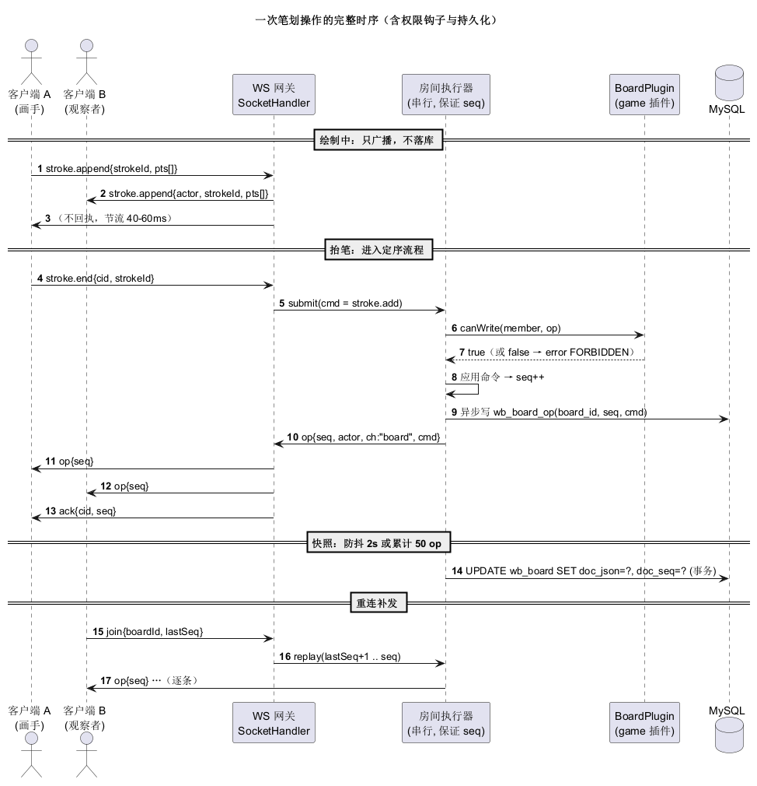

# 02 · 通信协议

> 版本：`protocolVersion = 1`　|　传输：WebSocket 文本帧（JSON）　|　最后更新：2026-11-13

## 1. 端点与握手

| 项 | 值 |
| :--- | :--- |
| 路径 | `GET /ws`（Spring `WebSocketHandler` 注册，不带 SockJS） |
| 鉴权 | V1：匿名，`join` 里带昵称；V2：`?token=<JWT>` 或首帧 `auth` |
| 子协议 | 无 |
| 心跳 | 客户端每 25s 发 `ping`，服务端 60s 内未收到任何帧则关闭 |
| 最大帧 | 256 KB（超出直接关闭，`error.code = FRAME_TOO_LARGE`） |

握手后客户端**必须**先发 `join`，否则 10s 内断开。

## 2. 消息封装

所有消息是 JSON 对象，公共字段：

| 字段 | 类型 | 说明 |
| :--- | :--- | :--- |
| `t` | string | 消息类型（见下表），必有 |
| `cid` | string | 客户端请求 ID，用于 `ack` 对账；需要回执的消息必带 |
| `ts` | long | 客户端时间戳（ms），仅调试用 |

服务端**不做字段顺序、未知字段处理**：未知字段忽略，缺失必填字段回 `BAD_REQUEST`。

## 3. 客户端 → 服务端

| `t` | 字段 | 说明 |
| :--- | :--- | :--- |
| `join` | `boardId`, `lastSeq`, `token?`, `nickname?` | 加入 / 重连。`lastSeq` 为已应用的最大序号，首次传 0 |
| `op` | `cid`, `ch`, `cmd` | 提交一个命令；`ch` ∈ `board` \| `game` |
| `stroke.append` | `pageId`, `strokeId`, `tool`, `color`, `width`, `pts[]` | 绘制中的增量点，**高频**，40–60ms 一批 |
| `stroke.end` | `cid`, `strokeId` | 抬笔，服务端据此落定为一条 `stroke.add` |
| `cursor` | `x`, `y` | 世界坐标光标，**50ms 节流** |
| `ping` | — | 心跳 |

**`stroke.append` 说明**：`pts` 是扁平数组 `[x1,y1,x2,y2,...]`，单帧 ≤ 512 点。服务端**不分配 seq、不落库**，只做房间内广播——保证实时性的同时不给 op 日志制造噪声。

## 4. 服务端 → 客户端

| `t` | 字段 | 说明 |
| :--- | :--- | :--- |
| `init` | `boardId`, `seq`, `doc`, `me`, `members[]`, `game?` | 首次加入或全量重同步 |
| `op` | `seq`, `actor`, `ch`, `cmd` | 已定序的广播 |
| `ack` | `cid`, `seq` | 命令已被接受并分配序号 |
| `stroke.append` | `actor`, `pageId`, `strokeId`, `tool`, `color`, `width`, `pts` | 他人绘制中的增量 |
| `stroke.end` | `actor`, `strokeId`, `seq` | 他人抬笔，随后会收到对应的 `op:stroke.add` |
| `cursor` | `actor`, `x`, `y` | 他人光标 |
| `presence` | `members[]` | 成员变化时**全量**下发，不做增量 diff |
| `error` | `cid?`, `code`, `msg` | 错误 |
| `pong` | — | 心跳回执 |
| `game.state` | `state`, `round`, `drawerId`, `endsAt`, `mode` | V2 预留 |
| `game.word` | `word` | V2 预留，**只发给当前画手** |

`me` / `members[]` 元素：

```json
{ "id": "u_2a", "name": "张三", "role": "editor", "online": true }
```

`role` ∈ `owner` \| `editor` \| `viewer`。

## 5. board 命令（`op.cmd`）

| `cmd.t` | 字段 | 权限 | 服务端动作 |
| :--- | :--- | :--- | :--- |
| `stroke.add` | `pageId`, `stroke` | editor+ | 校验后追加到页尾，分配 seq |
| `stroke.erase` | `pageId`, `ids[]` | editor+，且只能删自己画的（owner 可删任意） | 按 id 删除 |
| `object.add` | `pageId`, `object` | editor+ | 追加 |
| `object.patch` | `pageId`, `id`, `patch` | editor+ | 合并字段（浅合并） |
| `object.remove` | `pageId`, `ids[]` | editor+ | 删除 |
| `page.add` | `page` | editor+ | 追加一页 |
| `page.rename` | `pageId`, `name` | editor+ | 改名 |
| `page.clear` | `pageId` | owner | 清空该页元素 |
| `board.reset` | — | owner | 清空所有页（保留 1 页） |

示例：

```json
{ "t": "op", "cid": "c-17", "ch": "board",
  "cmd": { "t": "stroke.erase", "pageId": "p_1", "ids": ["s_9f21"] } }
```

**服务端校验顺序**：连接已认证 → 成员存在 → 角色满足 → 页面存在 → `cmd` 字段合法 → 应用 → 分配 seq → 广播 → 异步落库。

## 6. game 命令（V2 预留，V1 仅回 `NOT_IMPLEMENTED`）

| `cmd.t` | 字段 | 谁能发 | 说明 |
| :--- | :--- | :--- | :--- |
| `game.start` | `mode`, `rounds`, `seconds` | owner | 开始一局 |
| `game.guess` | `text` | 非当前画手 | 提交答案 |
| `game.skip` | — | owner | 跳过本轮 |
| `game.next` | — | owner | 下一轮 |
| `game.stop` | — | owner | 结束 |

游戏消息**与 board 命令共用一条连接**，靠 `ch` 区分；权限、成员、在线状态共享，不另开连接。

## 7. 错误码

| `code` | 场景 | 客户端处理 |
| :--- | :--- | :--- |
| `UNAUTHORIZED` | 未 `join` / token 失效 | 重新登录 |
| `FORBIDDEN` | 角色不足 / 不是自己的笔划 | 提示并回滚本地操作 |
| `BAD_REQUEST` | 字段缺失或非法 | 打印日志，不重试 |
| `NOT_FOUND` | board/page 不存在 | 回大厅 |
| `SEQ_GAP` | `lastSeq` 超出可补发范围 | 忽略本地状态，重新 `join` |
| `RATE_LIMITED` | 超过 60 帧/秒 | 退避 1s |
| `FRAME_TOO_LARGE` | 帧超 256KB | 拆包重发 |
| `ROOM_FULL` | 房间人数满 | 提示 |
| `NOT_IMPLEMENTED` | 通道/功能在当前版本未实现（如 V1 的 `game`） | 提示"暂未开放" |
| `INTERNAL` | 服务端异常 | 提示重连 |

错误消息：

```json
{ "t": "error", "cid": "c-17", "code": "FORBIDDEN", "msg": "只能撤销自己的笔划" }
```

## 8. 定序、ack 与重连

```
客户端                         服务端（每房间一个串行执行器）
  │  op(cid=c-17)  ────────────▶ │ 校验 → 应用 → seq=813 → 落库
  │                              │ 广播 op(seq=813) 给房间所有人（含自己）
  │  ◀──────────── ack(cid,813)  │
  │  ◀──────────── op(seq,813)   │
```

- **同一 board 的 seq 连续递增**，客户端发现 `seq != lastSeq + 1` 时，进入重同步：发 `join{lastSeq}`，服务端补发缺口；缺口 > 200 条或日志已清理则回 `init` 全量。
- 客户端对 `cid` 维护**未确认队列**，收到 `ack` 或对应 `op` 后移除；断线重连后对未确认命令**重发**（服务端按 `cid` 幂等去重，去重窗口 5 分钟）。
- 自己的 op 也会收到广播（用于对齐服务端最终状态），已本地应用的按 `id` 幂等处理。

## 9. 节流与限流

| 通道 | 频率 | 手段 |
| :--- | :--- | :--- |
| `stroke.append` | 40–60ms/帧 | 前端按时间窗聚合点；单帧 ≤512 点 |
| `cursor` | 50ms | 前端节流；服务端丢弃超过 30Hz 的光标 |
| 其他 `op` | 人工触发 | 服务端 60 帧/秒/连接，超出回 `RATE_LIMITED` |
| 广播 | 每个 op 一次 | 房间成员 ≤ 20 |

## 10. 典型交互



**新建连接 + 首次同步**

```
C→S  {t:"join", boardId:"b_7f3a", lastSeq:0, nickname:"张三"}
S→C  {t:"init", seq:812, doc:{...}, me:{...}, members:[...]}
```

**两人同时画（A 画，B 观看）**

```
A→S  {t:"stroke.append", pageId:"p_1", strokeId:"s_9f", pts:[120,300,124,306]}
S→B  {t:"stroke.append", actor:"u_a", pageId:"p_1", strokeId:"s_9f", pts:[120,300,124,306]}
A→S  {t:"stroke.end", cid:"c-31", strokeId:"s_9f"}
S→A/B {t:"op", seq:813, actor:"u_a", ch:"board",
       cmd:{t:"stroke.add", pageId:"p_1", stroke:{id:"s_9f", ...}}}
S→A  {t:"ack", cid:"c-31", seq:813}
```

**断线重连**

```
C→S  {t:"join", boardId:"b_7f3a", lastSeq:800}
S→C  {t:"op", seq:801..812}   (逐条补发)
S→C  {t:"init", ...}          (缺口过大时才发)
```

## 11. 兼容策略

- 新增字段：服务端先发，客户端忽略未知字段 → 向后兼容。
- 删除/改义字段：升 `protocolVersion`，`init.me` 里带回服务端版本，客户端不匹配则提示刷新。
- `schemaVersion` 与 `protocolVersion` **独立**：文档结构变化不影响消息格式。
