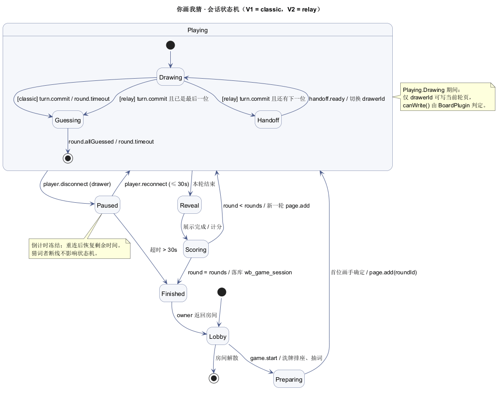

# 03 · 游戏状态机与白板映射

> 范围：V1 只做 `classic`（一人画、其他人猜），`relay`（接力）复用同一状态机，V2 打开。
> 图源文件：`diagrams/game-state.puml`

## 1. 状态定义

| 状态 | 含义 | 白板侧动作 | 可写页 |
| :--- | :--- | :--- | :--- |
| `Lobby` | 房间内等待，未开局 | 自由画板（无轮次页） | 所有成员（普通白板模式） |
| `Preparing` | 排座、抽词、确定轮数 | 建本轮页 `page.add` | 仅创建者 |
| `Playing.Drawing` | 当前画手作画 | 当前轮页可写 | **仅当前画手** |
| `Playing.Handoff` | 接力交接（relay） | 翻到新一轮页 | 无 |
| `Playing.Guessing` | 猜词 | 当前轮页只读 | 无 |
| `Paused` | 画手掉线，暂停 | 保持现状 | 无 |
| `Reveal` | 公布答案、展示画作 | 按轮次顺序只读翻阅 | 无 |
| `Scoring` | 结算得分 | 无 | 无 |
| `Finished` | 本局结束 | 可回到自由白板 | 所有成员 |

## 2. 事件

| 事件 | 来源 | 携带数据 |
| :--- | :--- | :--- |
| `game.start` | owner | `mode`, `rounds`, `seconds` |
| `turn.commit` | 当前画手 | 无（服务端把本轮页封板） |
| `round.timeout` | 服务端定时器 | `round` |
| `guess.submit` | 非画手 | `text` |
| `round.allGuessed` | 服务端判定 | — |
| `player.disconnect` | 连接关闭 | `userId` |
| `player.reconnect` | 重连 | `userId` |
| `game.skip` | owner | — |
| `game.stop` | owner | — |
| `handoff.ready` | 下一位画手 | `userId` |

## 3. 转换表

| 当前 | 事件 | 守卫 | 目标 | 动作 |
| :--- | :--- | :--- | :--- | :--- |
| `Lobby` | `game.start` | 人数 ≥ 2 且发送者是 owner | `Preparing` | 洗牌排座、抽词 |
| `Preparing` | — | 首位画手已确定 | `Playing.Drawing` | `page.add(roundId)`，私有下发 `game.word` |
| `Drawing` | `turn.commit` / `round.timeout` | `mode=classic` | `Guessing` | 本轮页封板（只读） |
| `Drawing` | `turn.commit` / `round.timeout` | `mode=relay` 且还有下一位 | `Handoff` | 建下一页 |
| `Handoff` | `handoff.ready` | — | `Drawing` | 切换 `drawerId` |
| `Drawing` | `turn.commit` | `mode=relay` 且已是最后一位 | `Guessing` | — |
| `Guessing` | `round.allGuessed` / `round.timeout` | — | `Reveal` | 广播答案 |
| `Reveal` | 展示完成（3s 或 owner 点下一轮） | — | `Scoring` | 计算得分 |
| `Scoring` | 自动 | `round < rounds` | `Playing.Drawing` | 新一轮 `page.add` |
| `Scoring` | 自动 | `round = rounds` | `Finished` | 落 `wb_game_session` |
| `Playing.*` | `player.disconnect` | 断线者是 `drawerId` | `Paused` | 记录恢复点 |
| `Paused` | `player.reconnect` | ≤ 30s 且同一用户 | `Playing.Drawing` | 恢复倒计时 |
| `Paused` | 超时 | > 30s | `Finished` | 广播"游戏中止" |
| `Finished` | owner 返回 | — | `Lobby` | 恢复自由白板 |
| `Lobby` | 全员离开 | — | `[终止]` | 解散房间 |

## 4. 状态机图



> 源文件 `diagrams/game-state.puml`，改图后按 `docs/00-README.md` 的"重新出图"导出 PNG。结构速览：

```
[*] → Lobby → Preparing → Playing{Drawing ⇄ Handoff, Drawing → Guessing}
                                   ↓
                                 Reveal → Scoring ─┬→ Playing（还有轮）
                                                   └→ Finished → Lobby → [*]
                    Playing ⇄ Paused（画手断线）
```

## 5. 与白板的三个接缝（这是"部件化"的全部代价）

### 5.1 页 = 轮次

每轮开局执行一次 `page.add`：

```json
{ "t": "op", "ch": "board", "cmd": {
    "t": "page.add",
    "page": { "id": "p_3", "name": "第 3 轮", "roundId": "r_3", "elements": [] } } }
```

游戏结束时所有轮次页都可回看——直接复用白板的**多页浏览**，不需要另写播放器。

### 5.2 写权限钩子

服务端在应用命令前调用插件：

```java
boolean canWrite(RoomCtx ctx, Member m, BoardOp op) {
    if (state != Drawing) return false;                 // 非作画阶段一律只读
    if (!op.pageId().equals(currentPageId)) return false;
    return m.id().equals(state.drawerId());             // 只有当前画手
}
```

前端用 `kernel.setPolicy(...)` 做**同样的判断**，让"不能画"在 UI 上就被拦住（服务端仍然兜底）。

### 5.3 私有消息通道

- 词只发给当前画手：`game.word` **单发**给该连接，不进房间广播。
- 猜词判定的正确答案**永不**出现在任何广播里，直到 `Reveal`。
- 猜词消息不走 `board` 通道，走 `game` 通道，由插件处理。

## 6. 防作弊清单

| 风险 | 对策 |
| :--- | :--- |
| 前端能看到答案 | 词只下发画手；`Reveal` 前服务端不下发 |
| 改前端伪造猜中 | 服务端比对（去空格、全半角归一、同义词表） |
| 猜词刷屏 | 每人每轮最多 20 次；50ms 节流 |
| 画手用外部工具 | 无法防，课设不管 |
| 观战者偷看其他轮页面 | 非当前页只读且只在 `Reveal` 解锁 |

## 7. 计分（服务端计算）

```
猜中者得分 = ceil(10 * 剩余秒数 / 总秒数)        // 越早越高，最高 10
画手得分   = 3 * 猜中人数                        // 鼓励画得清楚
全轮无人猜中：画手 0，猜中者 0
```

## 8. 断线与暂停

| 场景 | 处理 |
| :--- | :--- |
| 画手断线 | 进入 `Paused`，房间广播；倒计时冻结 |
| 30s 内重连 | 回到 `Drawing`，剩余时间恢复 |
| 超时 | `Finished`，展示已完成的轮次 |
| 猜词者断线 | 不影响，重连后收 `init` 恢复 |
| owner 断线 | 5s 后自动转移给最早加入的在线成员 |

## 9. V1 / V2 范围

| 能力 | V1（先做） | V2 |
| :--- | :--- | :--- |
| 玩法 | `classic` | `relay`（接力）、题目难度 |
| 词库 | 内置 100 词，JSON 种子 | 分类、难度、自定义房间词库 |
| 计分 | 简单时间分 | 连击、成就 |
| 观战 | 不支持 | 支持 |
| 回放 | `Reveal` 翻阅页面 | 逐笔回放（按 seq 重放） |
